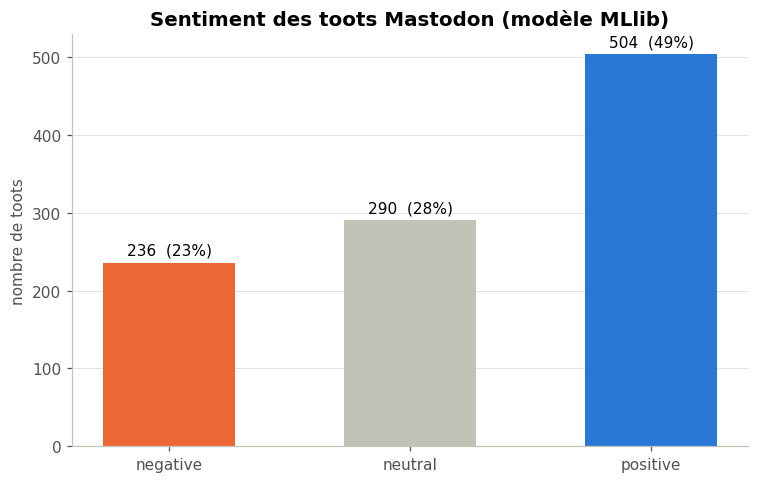
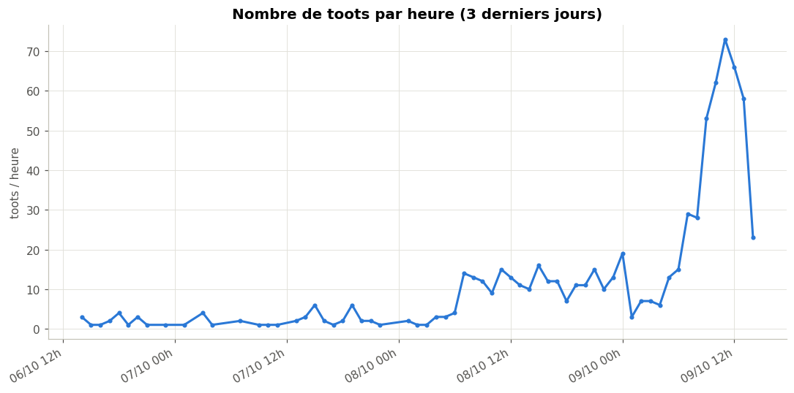
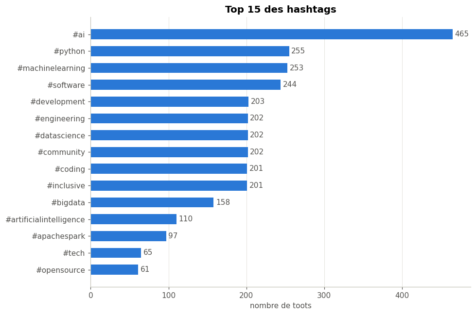
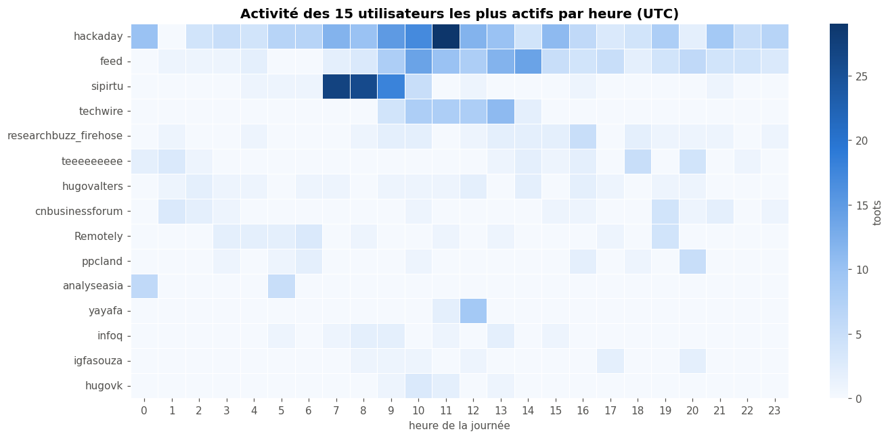
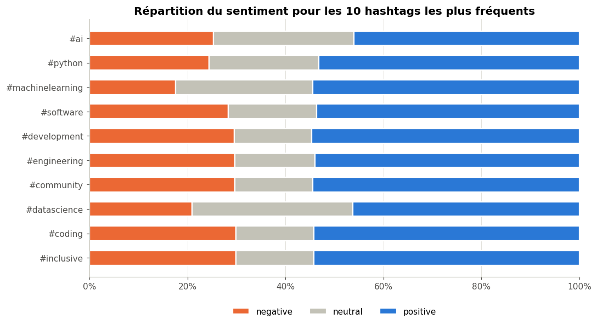
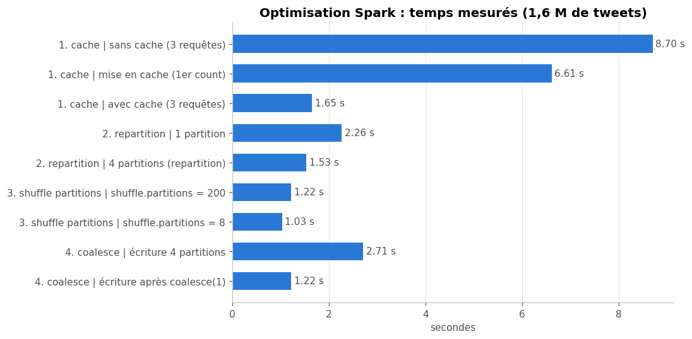

# Mastodon Data Pipeline – Projet final 5SPAR (Apache Spark)


| | |
|---|---|
| **École** | SUPINFO Lyon |
| **Formation** | Master Data Engineering |
| **Module** | 5SPAR – Apache Spark |
| **Binôme** | Ilyas BENAHMED · Mahmoud QZIBAR |

Pipeline de données **temps re1el + batch** sur des toots Mastodon.


| Partie | Contenu | Fichier |
|---|---|---|
| 1 | Ingestion Mastodon → Kafka | `ingestion/mastodon_producer.py`, `docker-compose.yml` |
| 2 | Spark Structured Streaming → PostgreSQL | `notebooks/01_streaming.ipynb` |
| 3 | Batch + optimisation (cache, repartition, coalesce) | `notebooks/02_batch.ipynb` |
| 4 | Analyse de sentiment (Spark MLlib) | `notebooks/03_sentiment.ipynb` |
| 5 | Visualisations (Matplotlib / Seaborn) | `notebooks/04_visualisation.ipynb` |
| – | Fonctions partagées (SparkSession, JDBC) | `notebooks/mastodon_utils.py` |

## Prérequis
- Docker Desktop (ou Docker Engine + Compose v2), **6 Go de RAM** alloués à Docker
- Ports libres : 8888, 4040-4045, 5432, 9094
- Un compte Mastodon (ex. mastodon.social)
- Le dataset [Sentiment140](https://www.kaggle.com/datasets/kazanova/sentiment140) (Kaggle) pour les parties 3 et 4

## Installation et lancement

### 1. Credentials Mastodon
1. Sur son instance Mastodon : **Préférences → Développement → Nouvelle application** (scope `read` uniquement)
2. Récupérer le **jeton d'accès** (access token)
3. Créer le fichier `.env` à partir du modèle et y coller le jeton :
```bash
cp .env.example .env
```
Le fichier `.env` est ignoré par Git (il contient le token).

### 2. Démarrer l'infrastructure
```bash
docker compose up -d          # kafka, postgres, jupyter
docker compose ps             # les 3 services doivent être "running"
```

### 3. Créer le topic Kafka (auto-création désactivée)
```bash
docker compose exec kafka /opt/kafka/bin/kafka-topics.sh --bootstrap-server localhost:9092 \
    --create --topic mastodon_stream --partitions 3 --replication-factor 1
```

### 4. Lancer l'ingestion Mastodon → Kafka
```bash
docker compose up -d --build producer
docker compose logs -f producer
```
Vérifier les messages dans Kafka :
```bash
docker compose exec kafka /opt/kafka/bin/kafka-console-consumer.sh --bootstrap-server localhost:9092 \
    --topic mastodon_stream --from-beginning --max-messages 3 --property print.key=true
```

### 5. Dataset Sentiment140
Télécharger l'archive sur Kaggle et placer `training.1600000.processed.noemoticon.csv` dans `data/`
(ignoré par Git, 240 Mo).

### 6. Notebooks (dans l'ordre)
JupyterLab : http://localhost:8888/lab?token=mastodon → `work/notebooks`

1. `01_streaming.ipynb` – lancer toutes les cellules et **laisser tourner** (le streaming écrit en continu dans PostgreSQL)
2. `03_sentiment.ipynb` – entraîne le modèle puis classe les toots (table `toots_sentiment`)
3. `02_batch.ipynb` – analyses batch + mesures d'optimisation (tables `batch_*`)
4. `04_visualisation.ipynb` – graphiques (sauvegardés dans `notebooks/figures/`)

> Chaque notebook ouvre sa propre SparkSession (~2 Go). Fermer le noyau d'un notebook terminé
> (*Kernel → Shut Down Kernel*), sauf celui du streaming.

## Détails techniques

### Partie 1 – Ingestion (Kafka)
- **Source** : API Mastodon via `Mastodon.py`, hashtags suivis configurables (`HASHTAGS` dans `.env`) + timeline publique filtrée par mots-clés (`KEYWORDS`)
- **Historique** : au démarrage, `BACKFILL_PAGES` pages de 40 toots par hashtag
- **Temps réel** : polling toutes les `POLL_INTERVAL` secondes avec `since_id` (seulement les nouveaux toots). Choix du polling plutôt que l'API streaming : plus robuste, et largement sous la limite de **300 requêtes / 5 min**
- **Nettoyage** : HTML → texte, boosts ignorés, doublons supprimés
- **Kafka** : topic `mastodon_stream`, 3 partitions, clé = `user_id` (ordre conservé par utilisateur)
- **Champs** : `toot_id, created_at, user_id, username, instance, text, language, hashtags, favourites_count, reblogs_count, replies_count, location…` – `location` est toujours vide : Mastodon n'expose pas de géolocalisation

### Partie 2 – Spark Structured Streaming
- Lecture du topic Kafka (`readStream`), parsing JSON avec un schEma explicite (`from_json`)
- **Transformation 1** : filtre sur la langue (`en`, `fr`) toots vides exclus et detection de mots-clés (`has_keyword`)
- **Transformation 2** : fenetres de 1 minute sur l heure de publication (`window`) avec un **watermark** de 10 min
- **Action 1** : nombre de toots par fenêtre → `toots_per_minute` (mode *append* : une fenetre est ecrite une fois terminee)
- **Action 2** : longueur moyenne des toots par hashtag et par utilisateur → `stats_by_hashtag`, `stats_by_user` (mode *complete*)
- Ecriture PostgreSQL via `foreachBatch` + JDBC, checkpoints pour reprendre la ou on s etait arreté

Demo en temps reel :
```bash
docker compose exec postgres psql -U spark -d mastodon
SELECT count(*), max(event_time) FROM toots;
\watch 5
```

### Partie 3 – Batch et optimisation
- Chargement de l historique depuis PostgreSQL (`spark.read.jdbc`)
- Utilisateurs actifs (≥ 3 toots) et hashtags par jour et hashtag n°1 de chaque jour (`Window` + `row_number`) et toots par jour et longueur moyenne et engagement moyen
- **Optimisation** mesuré sur les 1,6 M de tweets de Sentiment 140 (les 1000 toots sont trop peu pour voir une difference) :
  - `cache()` : evite de relire le CSV a chaque action
  - `repartition(n)` : 1 partition= 1 seul coeur utilisé / n partitions = n cœurs
  - `spark.sql.shuffle.partitions` : 200 (defaut) vs 8 adapté a notre volume
  - `coalesce(1)` : un seul fichier / une seule connexion JDBC pour ecrire un petit resultat
  - chaque mesure est nommé dans la Spark UI (`setJobDescription`), resultats dans `batch_benchmark`

### Partie 4 – Sentiment (Spark MLlib)
- Entrainement sur 20% de Sentiment 140 (320 000 tweets annotés positif / negatif)
- Pipeline : `Tokenizer` → `StopWordsRemover` (negations conservees) → `CountVectorizer` → `IDF` → `LogisticRegression`
- Evaluation sur 20% de test : **accuracy 0,776 – F1 0,776 – AUC 0,848**
- Application aux toots en anglais : *positive* (p ≥ 0,65), *negative* (p ≤ 0,35), *neutral* entre les deux → table `toots_sentiment`
- Limites : modele entrainé sur des tweets de 2009 en langage familier, appliqué uniquement a l anglais

### Partie 5 – Visualisations

**Répartition des sentiments** – 49% positif 28% neutre  23% negatif



**Nombre de toots par heure** (sur le 3 derniers jours)



**Top 15 des hashtags** – #ai on voit sa dominance



**Activité des utilisateurs les plus actifs par heure** – les comptes les plus actifs sont des bots qui publient a heures fixes



**Sentiment par hashtag**



**Optimisation Spark** – `cache()` rend les requetes ~5× plus rapides



## Tables PostgreSQL
| Table | Produite par | Contenu |
|---|---|---|
| `toots` | streaming | toots nettoyés (en/fr) |
| `toots_per_minute` | streaming | nb de toots par fenêtre de 1 min et par langue |
| `stats_by_hashtag` / `stats_by_user` | streaming | nb de toots + longueur moyenne |
| `toots_sentiment` | sentiment | toot + probabilité positive + sentiment |
| `batch_daily`, `batch_top_hashtags`, `batch_top_hashtag_per_day`, `batch_hashtags_per_day`, `batch_active_users`, `batch_user_hour_activity` | batch | agregations historiques |
| `batch_benchmark` | batch | temps mesures pour l optimisation |

## Dépannage
- **Spark plante (OutOfMemory)** : augmenter la RAM de Docker et fermer les noyaux des notebooks terminés
- **Erreur 401 coté producteur** : token invalide ou mauvaise instance dans `.env`
- **Le streaming refuse de redemarrer** : supprimer le checkpoint (`docker compose exec jupyter rm -rf /home/jovyan/checkpoints`) – les toots deja ecrits seront relus, le batch les redouble
- **Tout remettre a zéro** : `docker compose --profile stream down -v`
